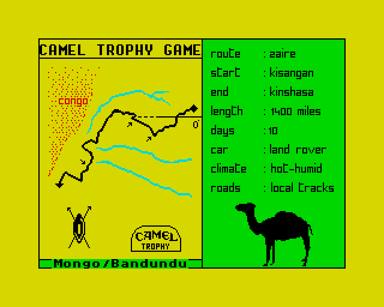
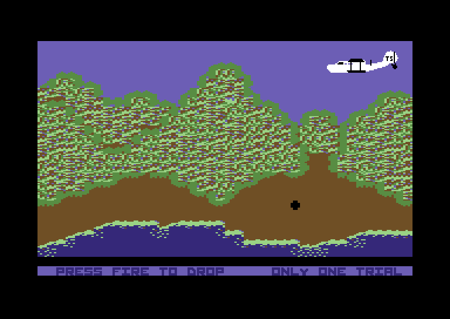
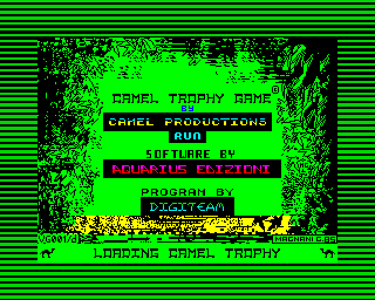
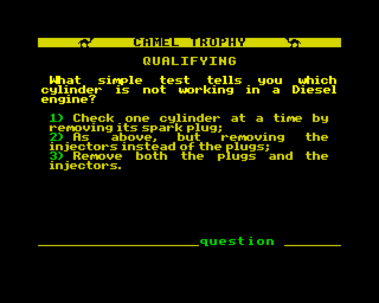
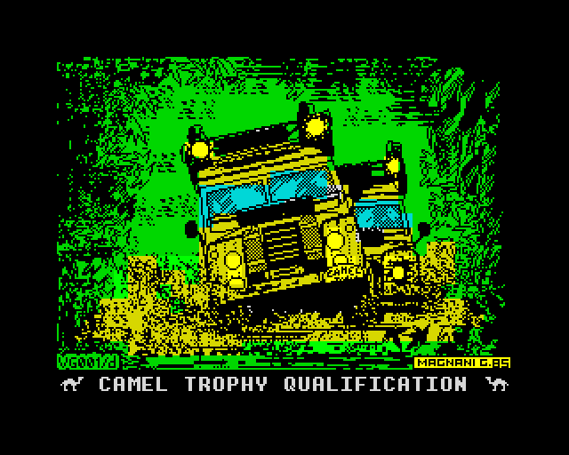
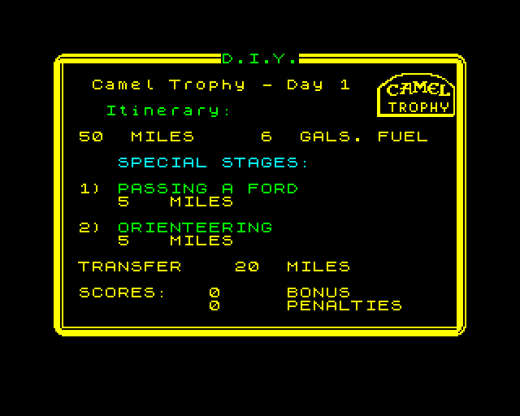
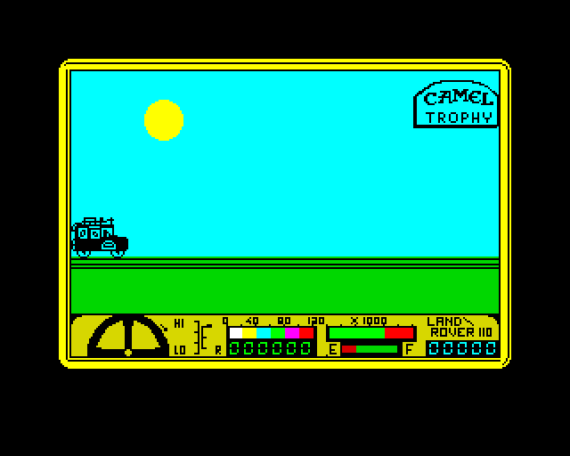
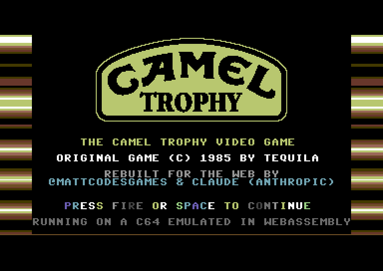
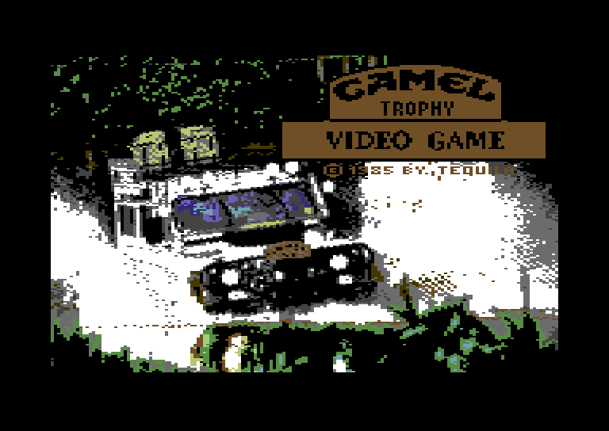
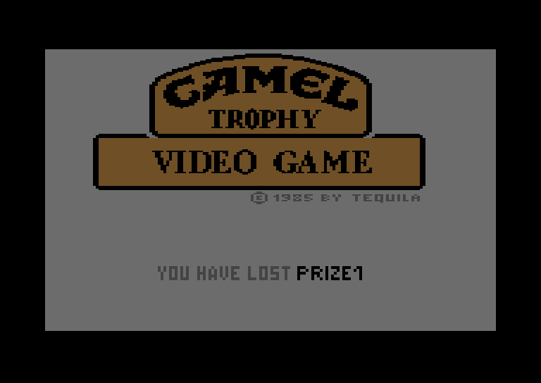

<div align="center">

# 🐪 Camel Trophy · 8-bit collection

**The 1985 Camel Trophy video games for the ZX Spectrum and Commodore 64, playable in your browser.**

Both games run on small emulators written in C and compiled to WebAssembly. There's nothing to install: open a page, click, and the original tape or disk loads itself.

[](https://mattcodesgames.github.io/camel-trophy-8bit/spectrum/)
[](https://mattcodesgames.github.io/camel-trophy-8bit/c64/)
[](https://mattcodesgames.github.io/camel-trophy-8bit/)

 

</div>

---

## 🟨 ZX Spectrum 48K: *Camel Trophy Game*, now in English

**[▶ Play it in your browser](https://mattcodesgames.github.io/camel-trophy-8bit/spectrum/)**

*Aquarius Edizioni, Italy, 1985.* Written by Simone Majocchi, Giorgio Arcangeli, Eugenio Ciceri and Bruno Molteni, and billed as the first major commercial game for the Italian Spectrum market.

| | | |
|:---:|:---:|:---:|
|  |  |  |
| Loading screen | Qualifying quiz | Route selection |
|  |  |  |
| Qualification | Day briefing | Driving |

The tape holds three parts, and each one loads the next when the game asks for it:

1. **Qualifying quiz**: 32 multiple-choice questions on off-road mechanics, survival, navigation and first aid. Your answers earn you a crew code.
2. **Route selection**: Zaire, the Amazon or Borneo, each with its own map and ten stages, or plan your own trophy in **D.I.Y.** mode.
3. **Driving game**: rebuild your Land Rover each morning, then tackle fords, humps, bridge building and jungle forks against the clock and the fuel gauge.

**The English edition.** The original is entirely in Italian. [`zx-spectrum/tools/translate.py`](zx-spectrum/tools/translate.py) produces an English tape from the untouched original. It rewrites and re-links the BASIC programs, patches the machine-code text in place, redraws the captions drawn into the pictures (borrowing glyphs from each picture's own font), and re-encodes the run-length-compressed route maps. All the English text lives in one table, [`translation_en.py`](zx-spectrum/tools/translation_en.py).

| Controls | |
|---|---|
| Start | Click the screen; `LOAD ""` is typed and the tape plays (turbo loading) |
| Quiz | number key to answer, `Enter` to confirm |
| Route | `Y` accepts a route |
| Driving | `2` for Kempston: arrow keys + `Tab`; or `1` for keyboard: `Q` `W` `E` `R` `T` |
| Rebuilding the car | `9` chooses a part, `0` picks it up |
| Extras | Load any part directly, one save slot, on-screen Spectrum keyboard |

---

## 🟪 Commodore 64: *Camel Trophy Video Game*

**[▶ Play it in your browser](https://mattcodesgames.github.io/camel-trophy-8bit/c64/)**

*Tequila, 1985.* A sequence of short joystick challenges set on the expedition.

| | | | |
|:---:|:---:|:---:|:---:|
|  |  |  |  |
| New title screen | Original title | Supply drop | Result |

- **Supply drop**: release the crate and steer its parachute onto the target.
- **Jungle drive**: keep the Land Rover clear of the bushes.
- **Refuelling**: waggle the joystick to fill the tank in time.
- **Bridge crossing** and a **rough-track** dash to the finish.

The disk is a cracked release by CFB. Its cracker intro is replaced by a new title and credits screen, written in 6502 assembly ([`commodore-64/tools/mkintro.py`](commodore-64/tools/mkintro.py)). It has a sprite-multiplexed Camel Trophy badge, raster bars and a SID tune. The game itself is unchanged, and the original disk image is kept in [`commodore-64/assets`](commodore-64/assets).

| Controls | |
|---|---|
| Joystick (port 2) | Arrow keys + `Space` to fire; gamepads work; on-screen pad on touch screens |
| Start | Fire skips the intro, fire again starts the game |
| C64 keys | `Enter` RETURN · `Esc` RUN/STOP · `F1`–`F7` · `PgDn` RESTORE |
| Save / load / reset | `F9` / `F10` / `F12` |

---

## 🔧 Under the bonnet

| | ZX Spectrum 48K | Commodore 64 (PAL) |
|---|---|---|
| CPU | Z80, all documented + undocumented opcodes and flags | 6510, documented + stable undocumented opcodes |
| Video | ULA with per-line border colour (loading stripes) | VIC-II: text/bitmap modes, sprites, raster IRQs, badlines |
| Sound | Beeper, box-filtered | SID: 3 voices, ADSR, sync/ring mod, filter |
| Media | Edge-accurate TZX/TAP playback, so custom turbo loaders run as-is | D64 disk with trapped KERNAL loading |
| ROM | Sinclair 48K ROM (© Amstrad, distributed with permission for emulators) | No Commodore ROMs: replacement kernel + original font |
| Source | [`zx-spectrum/`](zx-spectrum) | [`commodore-64/`](commodore-64) |

### Build

Both builds use [Zig](https://ziglang.org/) as a self-contained WebAssembly C toolchain:

```bash
python3 -m venv .venv && .venv/bin/pip install ziglang
ln -s ../.venv commodore-64/.venv
CC_WASM=".venv/bin/python -m ziglang cc" .venv/bin/python scripts/build_site.py
```

`scripts/build_site.py` builds both games (translating the Spectrum tape on the way) and publishes them into [`docs/`](docs), which GitHub Pages serves. Each game folder has its own README with more detail, and native test harnesses that run the emulators headless and take screenshots.

```
├── zx-spectrum/      Spectrum emulator, English translation tools, original + English tapes
├── commodore-64/     C64 emulator, new intro (6502 assembler in Python), disk images
├── docs/             GitHub Pages site: collection page, spectrum/, c64/, screenshots
└── scripts/          build_site.py
```

---

## 📚 Sources & credits

- [Spectrum Computing: *Camel Trophy Game*](https://spectrumcomputing.co.uk/entry/27508/ZX-Spectrum/Camel_Trophy_Game): publisher, year, authors, price (Lit. 12,000) and the Camel Productions licence.
- [“Camel Trophy Videogame: 20 years later”](https://www.rescogita.com/cvg/cvgfeature_en_01.php), Steed Kulka (Rescogita): how the Spectrum game was conceived in 1984 and built in Milan, with the master tape duplicated on 16 September 1985.
- [Lemon64: *Camel Trophy*](https://www.lemon64.com/game/camel-trophy) and [CSDb: *Camel Trophy Video Game*](https://csdb.dk/release/?id=93032): the Commodore 64 game by Tequila.
- [Camel Trophy Portugal: Camel Trophy for the Commodore 64](https://www.cameltrophyportugal.com/automobilia/camel-trophy-commodore-64/): the C64 challenges described.
- [Wikipedia: Camel Trophy](https://en.wikipedia.org/wiki/Camel_Trophy): the real expedition (1980–2000).
- ZX Spectrum 48K ROM © Amstrad plc, used with Amstrad's standing permission for emulators. This copy comes from the [Fuse](https://sourceforge.net/projects/fuse-emulator/) emulator project.

The original games are © their respective owners. *Camel* and *Camel Trophy* are trademarks of their owners. This is a non-commercial preservation project and isn't affiliated with or endorsed by them.

<div align="center">

Rebuilt for the web by **[@mattcodesgames](https://github.com/mattcodesgames)** with Claude (Anthropic).

</div>
